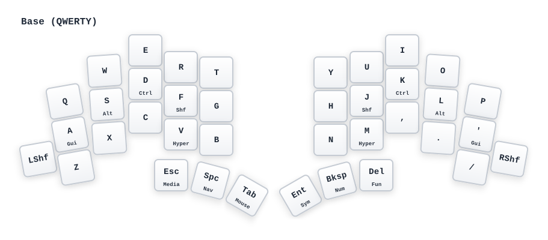
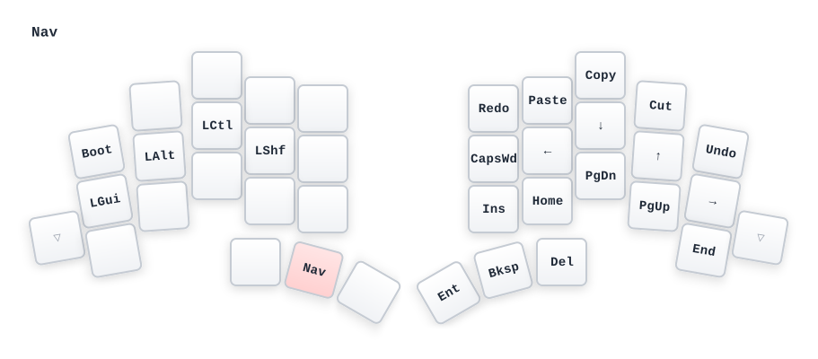
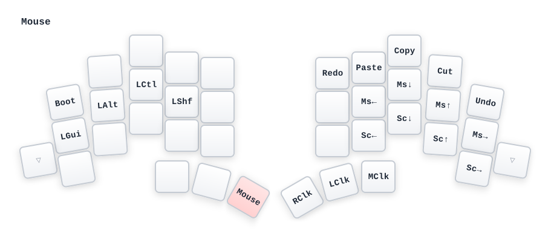
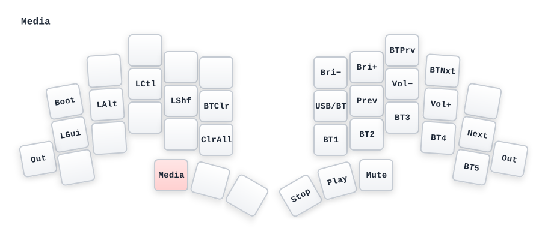
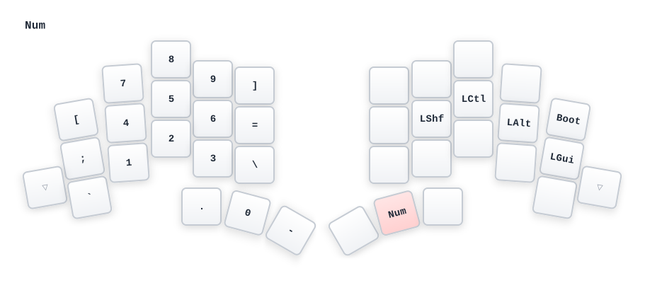
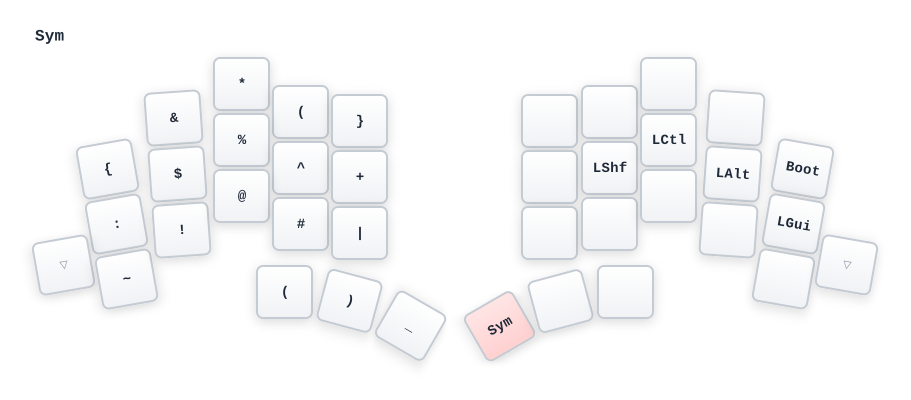
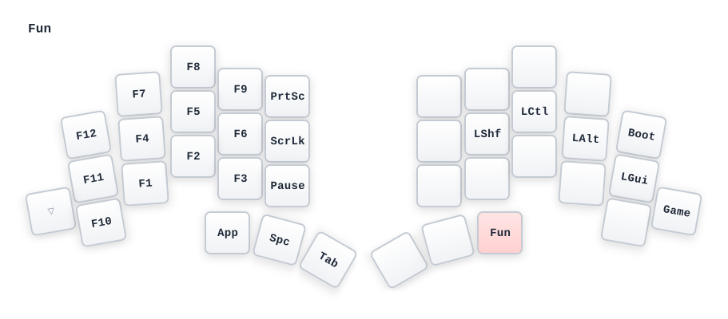
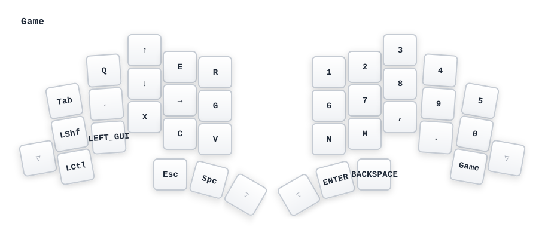
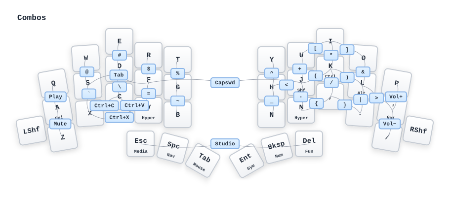

# TOTEM

ZMK firmware for the [TOTEM](https://github.com/GEIGEIGEIST/TOTEM) 38-key split keyboard by GEIGEIGEIST, running on two Seeed XIAO nRF52840 Sense controllers.

## Layout

**Miryoku** on **QWERTY**: home row mods (GACS order), six thumb-held layers, combos, mouse keys, and a toggled Game layer.

### Thumbs

| | Outer | Middle | Inner |
|---|---|---|---|
| Left hand | Esc / **Media** | Space / **Nav** | Tab / **Mouse** |
| Right hand | Delete / **Fun** | Backspace / **Num** | Enter / **Sym** |

Tap for the key, hold for the layer. The hand holding a layer gets the home row mods; the other hand gets the layer's keys.

### Base (QWERTY)



- **Home row mods** (GACS): Gui/Alt/Ctrl/Shift on left, mirrored on right
- **Hyper** (all 4 mods) on V and M
- **Side buttons** (pos 20/31): dedicated LShift / RShift

### Nav (hold Space)



### Mouse (hold Tab)



### Media + Bluetooth (hold Escape)



### Num (hold Backspace)



### Sym (hold Enter)



### Fun (hold Delete)



### Game (toggle from Fun layer)



**Boot** on the top corner key of the hand holding a layer: double-tap to put that half into its bootloader.

## Combos (80ms timeout, Base layer)



## Home Row Mods

| Setting | Value |
|---|---|
| Flavor | balanced (positional hold-tap) |
| Tapping term | 280ms |
| Quick tap | 175ms |
| Require prior idle | 150ms |
| Hold trigger | opposite hand + thumbs only |

Thumb layer-taps use **hold-preferred** flavor with 200ms tapping term for fast layer activation.

## Hardware

| Component | Detail |
|---|---|
| Keyboard | TOTEM by GEIGEIGEIST |
| Controllers | 2x Seeed XIAO nRF52840 Sense |
| Keys | 38 (3x5 + 1 side + 3 thumb per hand) |
| Matrix | 4x10 (col2row) |
| Connection | USB-C or Bluetooth (5 profiles) |

## Building

### Local (Nix)

```bash
nix develop          # enter dev shell
totem                # build left + right + settings_reset
totem bootloader     # download XIAO bootloader
totem update         # west update
```

Outputs go to `build/`:
- `totem-zmk-left.uf2` (central)
- `totem-zmk-right.uf2` (peripheral)
- `totem-zmk-settings-reset.uf2` (bond/settings reset)

### GitHub Actions

Push to `config/` triggers a build via ZMK's reusable workflow. Download UF2 artifacts from the Actions tab.

### Regenerate layer SVGs

```bash
gen-svg    # regenerates assets/svg/layers/*.svg from keymap
```

## Flashing

1. Double-tap reset on the XIAO to enter UF2 bootloader (mounts as `XIAO-SENSE`)
2. Copy the appropriate `.uf2` file to the mounted drive
3. Flash left half first, then right half

To clear Bluetooth bonds, flash `totem-zmk-settings-reset.uf2` on **both** halves, then reflash the regular firmware.

## ZMK Studio

Runtime keymap editing is enabled. Unlock with the **LShift + RShift** combo (key positions 20 + 31).
